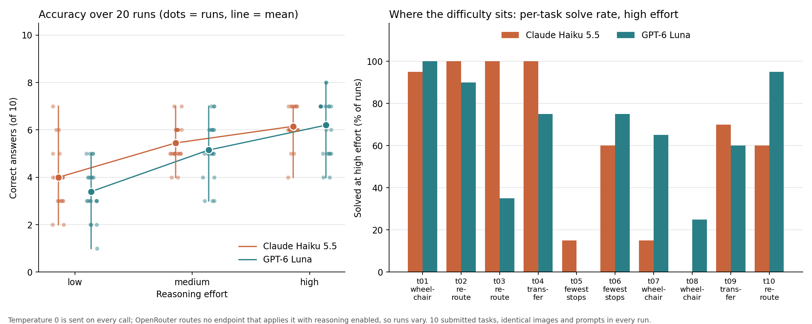

# NYC Subway Weekend Task Factory — Innodata Hackathon, Track 2

A pipeline that turns the MTA's public subway timetable into **realistic, MTA-style schematic maps with a weekend
service change** and asks a commuter question about each one ("No 2 or 3 trains between Park Place and Wall St —
which services do you ride from Delancey St to Franklin St?"). Every image is drawn by code from structured data,
every answer is computed by code from the same data, and independent checks confirm the image shows what the answer
assumes. On the final 10 tasks, over twenty complete runs at each reasoning effort, Claude Haiku 5.5 averaged 4.0 /
5.5 / 6.2 correct (low / medium / high) and GPT-6 Luna 3.4 / 5.2 / 6.2. Two tasks stay almost unsolved at high effort:
t05 (fewest stops, 3 of 40 high-effort runs) and t08 (wheelchair route, 5 of 40).

## Reported folders

- Tasks: `tasks/final`
- Results: `results/final` (run 1, high effort; repeats in `results/run2_*` … `results/run20_*`)
- Performance graph over the twenty runs: `docs/performance.png` (numbers in `docs/performance.json`)

## Problem statement

People plan real trips from transit maps, and the hardest moment is a weekend service change: a notice says a line
is suspended or a station is closed, and the rider has to re-plan using what the map shows: which services stop
where (express vs local), where transfers are, which stations are accessible. A wrong but confident answer sends
someone to a closed platform. We test whether multimodal models can **read a dense transit diagram and re-plan
correctly when the usual answer (memorised from the real NYC subway) is wrong**.

## How the pipeline works

```
MTA GTFS + station list ─► subway graph (data/*.json)
seed + spec ─► scenario: map window, weekend service change, origin/destination, question type
           ─► renderer: schematic map PNG (lines, stop markers, transfer pills, notice, accessibility symbols)
           ─► answer computed by code on the modified network (generator/families/subway/family.py)
           ─► validate/: independent re-computation, render-vs-data, OCR, legibility, uniqueness, clearance
           ─► validate/review.py: adversarial LLM audit (Claude Opus 5.5) of every task
           ─► eval/: OpenRouter calls, answer extraction, scoring, report
```

| Folder | Contents |
|---|---|
| `generator/families/subway/build_graph.py` | Builds `data/subway_graph.json` (weekday) and `data/subway_graph_saturday.json` from the MTA GTFS feed and the data.ny.gov station list: per-route stop sequences, median run times, transfer groups (MTA complex ids + GTFS transfers), accessibility, per-station trip counts (part-time stops) |
| `generator/families/subway/layout.py` | Octilinear schematic layout computed from real coordinates (our own algorithm, no published map traced) |
| `generator/families/subway/render.py` | MTA-style renderer: ribbon lines, a lettered marker on each line that stops (express lines pass with no marker), hollow markers for part-time stops, one-row transfer pills, connectors between joined stations, accessibility symbols, service-change overlay and notice, legend; plus a pixel audit for overlaps, mislabelled stations and markers sitting on lines that don't serve them |
| `generator/families/subway/family.py` | Scenario sampling, trip planner (Dijkstra over station × route × arrived-by-train states), question types |
| `generator/build.py` | spec → `tasks.jsonl`, `images/`, `data/` |
| `validate/` | `schema.py` (record format), `families/subway.py` (all task checks), `run.py`, `review.py` (adversarial reviewer) |
| `eval/` | OpenRouter client, prompt, extraction, scoring, runner |
| `factory/` | CLI: `build`, `validate`, `eval`, `reproduce`, `fresh` |
| `tests/`, `eval/tests/` | 94 tests: reproducibility, planner vs validator agreement, validator catches bad tasks, service-change semantics, schema vs the organizers' checker, layout, render audit, submission format |
| `docs/maps/nyc_subway_full_system.pdf` | The whole system rendered by the same code (weekday) |

### Question types

| Type | What the model must do | Answer |
|---|---|---|
| `reroute_lines` | Fewest transfers, then fewest stops, from A to B under the change; list the services ridden | sequence; any service running between the same two stations on a leg is accepted (`accepted_answers`) |
| `accessible_route` | Same, but boarding, alighting and transfers only at stations with the accessibility symbol | sequence (same acceptance rule) |
| `transfer_station` | The single station where the best one-transfer trip changes trains | station name as printed |
| `min_stops` | Fewest station stops from A to B (transfers allowed, free) | integer |

Every question states the rules: walking between stations joined on the map counts as a transfer, and the trip ends
when a train arrives at the destination itself.

## Project structure

```
innodata-hackathon-team-2/
├── README.md
├── Dockerfile                    Python + Tesseract OCR + fixed fonts
├── requirements.txt
├── .env.example                  template for OPENROUTER_API_KEY (copy to .env, never committed)
│
├── configs/
│   ├── pilot.json                pilot 1 spec (12 tasks)
│   ├── pilot2.json               pilot 2 spec (12 tasks)
│   ├── candidates.json, cand_pool.json   candidate pools for the final selection
│   └── final.json                final spec: the 10 reported tasks (seeds, levels, types, styles)
│
├── data/
│   ├── subway_graph.json         weekday service graph
│   ├── subway_graph_saturday.json  weekend graph used by every task
│   └── nyc_boroughs.geojson      NYC Open Data shorelines (land/water)
│
├── docs/maps/
│   └── nyc_subway_full_system.pdf
│
├── generator/                    makes the maps and questions
│   ├── base.py                   Family interface
│   ├── build.py                  spec → tasks/<set>/
│   └── families/subway/
│       ├── build_graph.py        MTA GTFS → subway graph
│       ├── layout.py             octilinear schematic layout
│       ├── render.py             MTA-style map renderer + pixel audit
│       └── family.py             question types and answers
│
├── validate/                     checks every task before it is used
│   ├── run.py, schema.py         task-record and answer checks
│   ├── families/subway.py        render-vs-data, OCR, label clearance
│   └── review.py                 adversarial AI reviewer
│
├── eval/                         evaluates the models (the agents under test)
│   ├── prompt.py                 prompt sent with each map
│   ├── openrouter.py             API client with retries
│   ├── extract.py                pulls out the FINAL ANSWER
│   ├── score.py                  marks each answer right or wrong
│   ├── run.py                    runs every model × task, writes results/
│   └── tests/                    pytest suite (API faked)
│
├── factory/__main__.py           command line
├── scripts/                      effort_sweep.sh, repeat_runs.sh (exact eval commands), plot_runs.py (graph)
├── docs/performance.png          accuracy over the twenty runs
├── tests/                        pytest suite: reproducibility, planner vs validator, render audit, format
├── tasks/final/                  the 10 reported tasks (built in Docker); pilot1/, pilot2/, candidates/ too
├── results/final/                reported run (both models, high); final_{haiku,luna}_{low,medium}/,
│                                 run2_* … run20_* (repeats), pilot1/, pilot2/, cand_*/ (earlier rounds)
├── slides/                       presentation
└── tools/check_submission.py     organizers' format checker
```

How the pieces connect:

```
configs → generator → tasks/ → validate → eval → results/
          (draw + ask)          (check)    (test models)
```

## How the tasks were made hard and why the models failed

- **Memory trap by construction.** A scenario is accepted only if the normal-service answer is different (stored as
  `normal_answer` in each task's data). A model that answers from memory of the NYC subway, or ignores the notice,
  is wrong.
- **Express vs local is read from markers.** A line has a lettered marker only where that service stops; an express
  line passes local stations with no marker. Planning the fewest stops needs this (t06: hop on the 4 express for one
  stop to skip Hoyt St — staying on the 2/3 is one stop longer).
- **Station closures make trains run through.** Counting stops or choosing transfers must skip the closed station.
- **Accessibility symbols restrict transfers.** Wheelchair routes must change only at stations with the symbol, so
  the usual transfer is often illegal.
- **Multi-leg planning on a dense map** (up to 3 rides), with complexes drawn as one-row pills joined by connectors.

Failure patterns in run 1, the reported run (see the hand check below):
- **Miscounting stops / missing an express hop** — t05: every run-1 answer wrong (Haiku 2 at all efforts, Luna 1);
  t06: Haiku low/high answered 5 (stay on the 2/3).
- **Ignoring the accessibility constraint** — t08: Haiku low answered F → 7 (changes at 42 St-Bryant Pk) and high
  D → E → 6 (changes at 7 Av), both stations without the symbol.
- **Legal but not shortest** — t08: Haiku medium D → 1 → S (7 stops vs 6); t07: Haiku low/high 1 → S → 7 (5 stops
  vs 4). Both are accessible trips with the right number of transfers but more stops.
- **Answering from normal service** — t10: Haiku medium/high used the 6, which is suspended between 28 St and
  Bleecker St.
- **Wrong transfer point** — t09: Chambers St instead of Canal St (Haiku low/medium, Luna); t04: Haiku medium chose
  59 St-Columbus Circle.
- **Illegal transfer** — t03: Haiku low J → A → 1 (no free transfer from the A to the 1 on this map).

### Failure analysis of the first two rounds

We sorted every wrong answer on a valid pilot task (13 in all: 5 Haiku, 8 GPT-6 Luna). For each one we compared the model's answer with alternative answers computed by code: the answer under normal service, and the answer without the accessibility constraint.

| Failure type | Count | Examples |
|---|---|---|
| **Ignored a stated constraint.** The answer is exactly the code-computed answer for normal service or without the ♿ rule | 4 | p1_03 Haiku: `Times Sq-42 St`, the normal-service transfer, but the 7 is suspended. p2_04 GPT: `5` stops, the normal-service count (6 with the R suspended). p2_05 Haiku and p2_09 GPT: the route without the accessibility rule. |
| **Misread which service runs where** | 4 | p1_07 Haiku: `["7","4"]`, but the 4 never reaches Lexington Av/63 St (correct: `["7","Q"]`). p2_05 GPT: `C` instead of `A` on a shared track. p2_01 Haiku: `7` instead of the `S` shuttle. |
| **Answer not supported by the map at all** | 2 | p2_06 GPT: `Bergen St`, a Brooklyn station that is not on the map. p2_11 GPT: `["6"]`, a service that serves neither the origin nor the destination. |
| **Wrong transfer station or label** | 2 | p2_10 Haiku: `42 St-Port Authority Bus Terminal`, the label at the other end of the Times Sq complex. p1_03 GPT: `34 St-Herald Sq`. |
| **Stop count off** | 1 | p1_01 GPT: `5` instead of `4`. |

## Pilot results

| Round | Generator | Tasks | Haiku 5.5 (high) | GPT-6 Luna (high) | Change made because of it |
|---|---|---|---|---|---|
| Pilot 1 | subway-0.2.0 | 12 (`tasks/pilot1`) | 10/12 (83%) | 9/12 (75%) | Both models solved every `count_stops`; the adversarial reviewer found an ambiguous walk-transfer. → dropped `count_stops` from the mix, required transfers inside one named station, added the `accessible_route` type, weekend (Saturday) timetable, MTA-style markers |
| Pilot 2 | subway-0.2.0 | 11 evaluated of 12 (`tasks/pilot2`) | 8/11 (73%) | 5/11 (45%) | `accessible_route` hardest (1/3 each). Test audit found the planner did not follow the stated walking/arrival rules and the accessible memory trap compared against the wrong baseline → planner rewritten on (station, route, arrived-by-train) states, rules stated in every question, closed stations never used as endpoints, U-turn trips rejected, max 3 rides |
| Final | subway-0.3.0 | 10 (`tasks/final`) | 5/10 (50%); mean of 20 runs 6.2 | 8/10 (80%); mean of 20 runs 6.2 | Hand check accepted all 10; equivalent services on the same legs accepted (e.g. A or C from 59 St to 42 St) |

Reasoning-effort sweep on the final 10, run twenty times (temperature 0 requested, same submitted images, same
prompts). Run 1 is the reported run; runs 2–20 are complete repeats, every one reported:

| Model · effort | runs 1–20 | mean | range |
|---|---|---|---|
| Claude Haiku 5.5 · low | 4, 4, 7, 5, 3, 3, 5, 4, 3, 2, 4, 2, 4, 4, 3, 4, 4, 6, 6, 3 | 4.0 | 2–7 |
| Claude Haiku 5.5 · medium | 5, 5, 4, 6, 6, 5, 7, 6, 6, 6, 5, 5, 4, 5, 6, 5, 6, 5, 5, 7 | 5.5 | 4–7 |
| Claude Haiku 5.5 · high | 5, 5, 7, 7, 6, 6, 6, 7, 7, 7, 6, 6, 6, 4, 7, 6, 6, 7, 6, 6 | 6.2 | 4–7 |
| GPT-6 Luna · low | 5, 4, 5, 4, 4, 4, 3, 3, 3, 3, 5, 3, 3, 2, 2, 2, 5, 1, 3, 4 | 3.4 | 1–5 |
| GPT-6 Luna · medium | 6, 5, 6, 5, 5, 6, 7, 5, 5, 5, 7, 4, 4, 5, 7, 6, 3, 3, 6, 3 | 5.2 | 3–7 |
| GPT-6 Luna · high | 8, 5, 4, 5, 4, 8, 7, 7, 7, 5, 5, 7, 7, 7, 7, 6, 6, 7, 5, 7 | 6.2 | 4–8 |

Per-task solve rate at high effort over the twenty runs (Haiku / Luna): t01 95 / 100%, t02 100 / 90, t03 100 / 35,
t04 100 / 75, t05 15 / 0, t06 60 / 75, t07 15 / 65, t08 0 / 25, t09 70 / 60, t10 60 / 95.



Folders: run 1 `results/final` (high) and `results/final_{haiku,luna}_{low,medium}`; runs 2–20
`results/run<N>_{haiku,luna}_{low,medium,high}`. Exact commands: `scripts/effort_sweep.sh` (runs 1–3) and
`scripts/repeat_runs.sh` (runs 4–20); graph: `python scripts/plot_runs.py`. The effort is sent as `reasoning.effort`
in `eval/openrouter.py` (`build_body`) and recorded in each folder's `run_config.json`. 1,200 replies in all, every
one complete (status ok, finish reason stop); total OpenRouter cost about $2.42.

## Key findings

- Generation yield (generator v0.3, 20 fresh seeds at level 3): 17 tasks built (3 seeds found no scenario meeting
  every rule within 400 attempts) and 16 passed every automatic check (1 map showed a part-time stop).
- Final accuracy at high reasoning: run 1 (the reported run) Haiku 5.5 5/10, GPT-6 Luna 8/10; over twenty complete
  runs both average 6.2/10 (Haiku range 4–7, Luna 4–8). The two models are tied on this set.
- More reasoning helps on these tasks: mean accuracy rises from low to medium to high for both models (Haiku 4.0 →
  5.5 → 6.2, Luna 3.4 → 5.2 → 6.2). Within the same run, high beat low in 17 of 20 runs for Haiku (3 ties) and 17 of
  20 for Luna (2 ties, 1 lower). The ranges still overlap, so a single run can show the opposite (after three runs
  we saw no consistent effect; the trend appeared only with more repeats).
- Robust failures at high effort over twenty runs: t05 (fewest stops) was solved 3 times by Haiku and never by Luna;
  t08 (wheelchair route) never by Haiku and 5 times by Luna; Haiku solved t07 (wheelchair route) 3 times. t02, t03 and
  t04 were solved in every high-effort run by Haiku, t01 in every one by Luna.
- The models fail on different tasks: Haiku solved t03 (reroute) in 20 of 20 high-effort runs and Luna in 7; Luna
  solved t07 in 13 and Haiku in 3. Across all efforts (60 replies per model per task) t05 was answered correctly 7
  times by Haiku and 4 by Luna, t08 0 and 7 times.
- Wheelchair routes: on t08 Haiku changed trains at stations without the symbol (run 1: 42 St-Bryant Pk at low, 7 Av at
  high); on t07 it chose a legal but longer route (1 → S → 7, 5 stops vs 4).
- Typical wrong answers at lower effort include legal-but-longer trips, e.g. Luna's 2 → Q on t02 (one stop more than
  4 → Q, because the 4 runs express).
- Run-to-run variance is large with temperature 0 requested (the providers do not apply it, see Evaluation settings):
  Luna at high effort ranged 4–8/10 across runs, so single-run comparisons between models or efforts are not
  reliable at this task count.
  An earlier run on the same 10 tasks built on macOS (8 of 10 images byte-identical) gave Haiku 6/10 and Luna 7/10 at
  high effort, and the judges' Docker `reproduce` check gave Haiku 7/10 and Luna 6/10; the macOS run was discarded so
  reported numbers come from complete runs on exactly the submitted images, and the Docker check ran outside the
  repository. Pilot and candidate runs are kept in `results/pilot1`, `results/pilot2` and `results/cand_*`.
- Adversarial review (Claude Opus 5.5 solving each task blind, then auditing the reference): all 10 final tasks
  valid; during development it caught real bugs (an ambiguous walk-transfer, a closed station used as a destination,
  an unstated arrival rule), each fixed in the generator.

## Hand check

Model outcomes quoted in these notes are from run 1; every run's per-task answers are in `results/`.
Every reported task was checked by a team member on a review page showing the map, the notice, the question, the
code-computed reference trip leg by leg, the reviewer's verdict and each model's reasoning. Verdict for all 10:
**reference trip correct, keep**.

| task_id | Type | Checked | Notes |
|---|---|---|---|
| t01 | accessible_route | Grand Central closed for 4/5/6; A → E → 6 traced on the map | C may replace A (59 St → 42 St), accepted. All run-1 answers correct |
| t02 | reroute_lines | R suspended Union St–Court St; 4 to Atlantic Av, Q to DeKalb Av | All high-effort answers correct; Luna low/medium answered 2 → Q (legal, one stop longer) |
| t03 | reroute_lines | 2/3 suspended Park Place–Wall St; J → R → 1 via Canal St and the Whitehall/South Ferry connector | Haiku low tried J → A → 1 (no free transfer from the A to the 1 here) |
| t04 | transfer_station | 7 suspended west of Grand Central; transfer at 34 St-Herald Sq | Haiku medium chose 59 St-Columbus Circle |
| t05 | min_stops | 7 suspended 5 Av–Hudson Yards; reference trip (3 stops) confirmed on the map | Run 1 all wrong (Haiku 2, Luna 1); over twenty high-effort runs Haiku solved it 3 times, Luna never |
| t06 | min_stops | Nevins St closed; stop count recounted by hand: 3 to Borough Hall (1), 4 express to Atlantic Av (1), 2 to Grand Army Plaza (2) = 4 | Staying on the 2/3 is 5 (also stops at Hoyt St); Haiku low/high answered 5 |
| t07 | accessible_route | Times Sq closed for the 7; A → S → 7 with accessible transfers | C may replace A, accepted. Haiku low/high chose 1 → S → 7: legal, but 5 stops vs 4 |
| t08 | accessible_route | Herald Sq closed for N/Q/R; D → A → S | Reviewer note: A, C or E from 59 St downtown — C accepted (the E doesn't serve that leg on this map). Haiku low/high changed trains at inaccessible stations (42 St-Bryant Pk, 7 Av); medium took a legal but longer route; Luna correct in run 1, F → S in run 2 |
| t09 | transfer_station | Fulton St closed for 4/5; transfer at Canal St | Haiku low/medium and Luna said Chambers St |
| t10 | reroute_lines | 6 suspended 28 St–Bleecker St; F → L | Haiku medium/high used the suspended 6 |

## Evaluation settings

- Models (OpenRouter): `anthropic/claude-haiku-5.5`, `openai/gpt-6-luna`. Reported run: both at `reasoning.effort=high`.
- `temperature=0` is sent on every call and recorded in every saved request. OpenRouter's model list does not show
  `temperature` as a supported parameter for either model, and asking OpenRouter to route only to endpoints that
  apply every parameter (`provider.require_parameters: true`) returns "No endpoints found that can handle the
  requested parameters" for both (checked 2026-11-14). The providers therefore ignore it, which is why we repeated
  every setting twenty times instead of relying on one run.
- Fixed `max_tokens=32000` (reasoning tokens count toward it). One call per model × task; no best-of selection.
- The image is sent as a base64 PNG data URL. `tasks/final` was built inside the Docker image, and the reported runs
  used exactly those files, so a judge's Docker rebuild reproduces the evaluated images byte for byte. (A macOS
  build gives identical questions and answers; two images differ slightly in marker layout because floating-point
  rounding differs across operating systems.)

### Prompt (`eval/prompt.py`)

```
{question}

Answer the question using the image. Think it through, then {format_instructions}
End your reply with a final line of the form:
FINAL ANSWER: <answer>
```

| answer_type | Format instruction |
|---|---|
| `integer` | give the answer as a single whole number (digits only, no units). |
| `label` | give the answer exactly as written on the map (just the name, nothing else). |
| `sequence` | give the answer as a JSON list of names exactly as written on the map, in order, e.g. ["A", "7"]. |

Every task's exact prompt is saved with its raw response (`results/<set>/raw/<model>/<task_id>.json`).
GPT-6 Luna's provider-encrypted reasoning blobs (`reasoning.encrypted`) are replaced by a note when saved: they
cannot be read, and their random text tripped the format checker's key scanner.

### Extraction and scoring

- **Extraction** (`eval/extract.py`): the last `FINAL ANSWER:` line (fallback: the last line); markdown, quotes and
  trailing periods stripped; sequences accept a JSON list, commas or arrows.
- **Scoring** (`eval/score.py`): `integer` exact; `label` after normalisation (case, punctuation, hyphen variants);
  `sequence` item by item, against the reference or any entry of the task's `accepted_answers`.

### Errors and retries

HTTP 429/5xx, timeouts and connection errors are retried with exponential backoff (up to 6 attempts). Any row with
an API error, an empty reply or `finish_reason` other than `stop` makes the run exit non-zero, so the reported run
must be re-run in full. The reported run has none.

### Outputs (`results/<set>/`)

`responses.csv` (the 10 required columns), `responses.jsonl` (same rows plus full replies and usage),
`run_config.json` (models, temperature, max_tokens, effort, prompt template, timestamps, cost), `summary.md`,
`raw/` (full API responses including reasoning text where returned).

## Run in Docker

Build the image (holds the whole pipeline and its dependencies):

```bash
docker build -t transport-factory .
```

Rebuild the 10 reported tasks from their seeds (identical images, questions and answers — the command compares
image hashes, questions and answers against `tasks/final` and prints the result), validate them, then evaluate both
models and score them. Choose the models with `--models`; the seeds are in `configs/final.json`:

```bash
docker run --rm -e OPENROUTER_API_KEY -v "$PWD/out:/app/out" transport-factory reproduce --spec configs/final.json --out out/final --compare tasks/final --models anthropic/claude-haiku-5.5,openai/gpt-6-luna
```

Build, check and score one fresh task. Choose the seed with `--seed`, the question type with `--question-type`
(`reroute_lines`, `accessible_route`, `transfer_station`, `min_stops`) and the model with `--models`:

```bash
docker run --rm -e OPENROUTER_API_KEY -v "$PWD/out:/app/out" transport-factory fresh --family subway --seed 12345 --level 3 --question-type reroute_lines --out out/fresh --models anthropic/claude-haiku-5.5
```

Outputs land in `./out/` on the host. The key is passed only at run time; no key or `.env` is copied into the image.

### Local runs and tests

```bash
python -m venv .venv && .venv/bin/pip install -r requirements.txt pytest
.venv/bin/python -m factory build --spec configs/final.json --out out/check        # build + validate
.venv/bin/python -m validate.review --tasks tasks/final                            # adversarial review (ANTHROPIC_API_KEY)
.venv/bin/python -m pytest -q                                                      # 94 pass, 16 expected failures (documented)
```

## Data sources and references

- MTA GTFS static subway feed (`https://rrgtfsfeeds.s3.amazonaws.com/gtfs_subway.zip`, feed of 2026-10-28) and the
  MTA Subway Stations dataset on data.ny.gov (`39hk-dx4f`): stops, service patterns, run times, complexes, accessibility.
- NYC Open Data Borough Boundaries (shoreline-clipped), `data/nyc_boroughs.geojson`, for land and water.
- Real examples each image is modelled on: the **MTA New York City Subway map (2026 edition)** — lettered stop
  markers on each line and transfer pills — and the **MTA's weekend planned-work notices / "The Weekender" maps**
  for the service-change overlay; the **April 2026 print map** for the `print` style. Our maps are generated from
  data with our own layout; no MTA artwork, logo or route bullets are reproduced (stop markers and route badges are
  rounded squares, and every map says "Schematic generated from public GTFS data. Not an official map.").

## Reused components

- Libraries: numpy, matplotlib, pillow, pytesseract (Tesseract OCR), requests, anthropic SDK, pytest.
- `tools/check_submission.py`: organizer-provided format checker.
- `eval/tests/` came from a teammate's parallel eval implementation (PR #1); 12 of its tests encode that
  implementation's conventions and are marked expected-failure with reasons in `eval/tests/conftest.py`.
- No pre-existing project code. Built with AI coding assistance (Claude Code).

## Manual interventions

- The 10 final tasks were picked from a candidate pool for variety of question type and area; seeds that duplicated
  another task's trip or answer were replaced by searching the next seeds (`configs/final.json` records the seeds).
- Hand check of all 10 on the review page; one note (t08: A/C/E equivalence) led to the general `accepted_answers` rule.
- Map styling was iterated by eye against the MTA reference maps (label placement, transfer rows, part-time markers).
- No task answer was edited by hand; every answer is computed by code.

## Limitations

- One diagram family (subway maps). The generator interface (`generator/base.py`) supports more.
- The schematic layout distorts geography; shorelines are warped to follow it and look rough in places.
- A few stations in the densest areas (Downtown Brooklyn) can have a marker sitting on another line; tasks touching
  them are rejected by the validator rather than fixed in the renderer.
- Part-time stops are inferred from trip counts (< 85% of both neighbours) and maps showing them are excluded.
- `tasks/pilot1` and `tasks/pilot2` were rebuilt after their runs as the generator changed; `results/pilot1` and
  `results/pilot2` reflect the builds that were evaluated (each raw response stores the exact prompt sent).
- Service patterns are a typical Saturday daytime pattern from the October 2026 feed, not a specific date.
- `temperature=0` is not applied by the providers (see above), so each run is a sample; we report twenty runs per
  setting; ranges still overlap between efforts.
- Equivalent-service acceptance treats services stopping at both stations of a leg as equivalent even when one is
  local (more stops); the question states this rule.

## Next steps

- **Harder trips across boroughs.** Each map today covers one area (for example Midtown West) and trips use at most
  3 rides. Larger maps spanning several boroughs would allow longer trips with more transfers and more places where
  a service change forces a detour.
- **Regional rail: LIRR, Metro-North and NJ Transit.** The MTA publishes GTFS feeds for the LIRR and Metro-North,
  and NJ Transit publishes its feeds through its developer portal. Adding them as a new line style would create
  questions that cross systems at Penn Station, Grand Central, Atlantic Terminal, Jamaica and Secaucus, where the
  rider must also tell subway transfers from rail connections.
- **More tasks.** 10 tasks are too few to separate the two models (both average 6.2/10 at high effort); 50+ tasks
  with repeated runs would.

## Team contributions

| Member | Contribution |
|---|---|
| Daniel Chen | Pipeline design, subway map renderer and task generator, validation, hand check of all 10 tasks |
| Iana Grytsenko | Evaluation module and tests (`eval/tests/`, PR #1), README project structure and pilot failure analysis |
| Ankith Nagabandi | TODO (contribution) |
